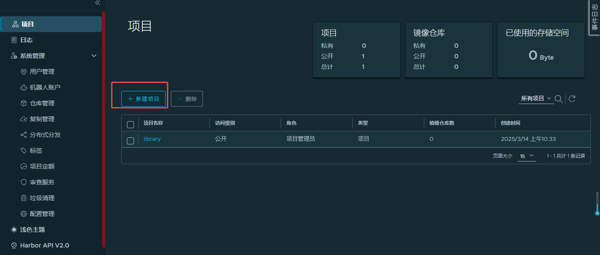
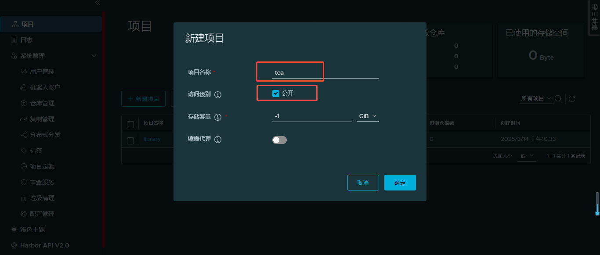
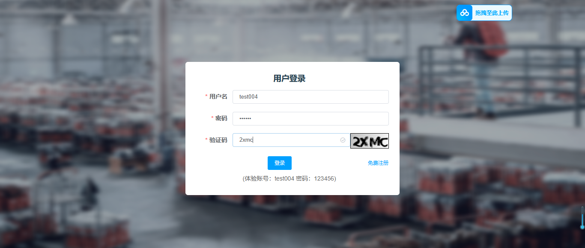
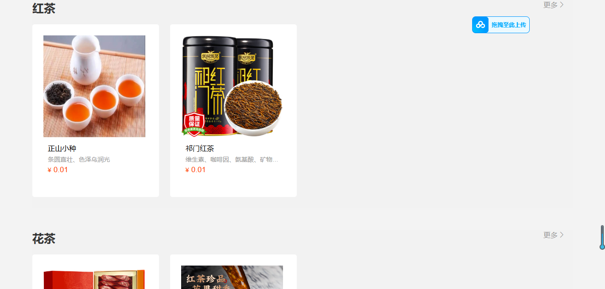
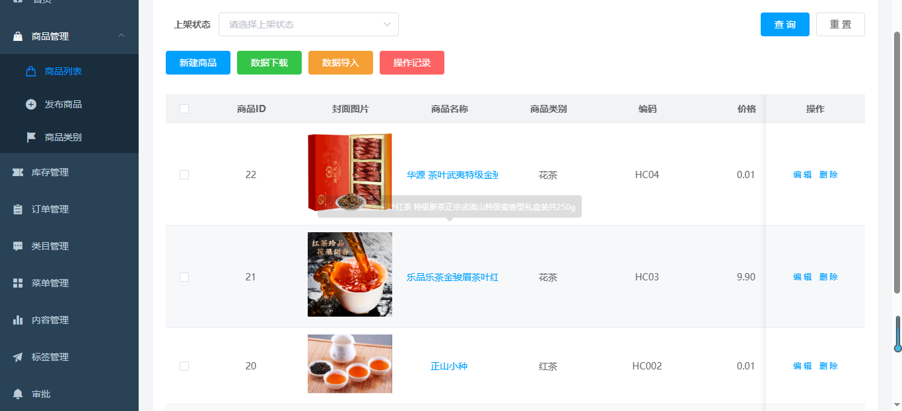

# 阿里云茶叶电商系统（学茶网）部署 SOP

**文档版本**：V1.0

**部署目标**：在阿里云上从零搭出一套茶叶电商系统（学茶网）。自建 Harbor 私有镜像仓库、Nacos 注册中心、RocketMQ 消息队列，数据层用云 RDS MySQL 和云 Redis，业务跑在 ACK 容器集群上，前端静态资源和业务 jar 走 NFS 共享挂载，最后用 SLB 对外发布。

**部署环境**：阿里云 ECS（Rocky Linux 8.5 / 8.9 x86_64）、ACK v1.32.1-aliyun.1、Harbor 2.5.3、Nacos 2.0.2、RocketMQ 4.9.4、nginx、containerd

> **关于本文档**：这是实验环境的部署记录，项目验收后所有云资源已释放。文中的口令、RDS/Redis 内网地址、公网 IP、实例 ID 均已用占位符替换，配置文件里的值可以直接照抄，替换成你自己的即可。

[TOC]

---

# 1. 部署架构与环境规划

## 1.1 资源清单

四台自建 ECS 放在同一个 VPC 里，走内网互通。

| 主机名 | 内网地址 | 配置 | 跑什么 |
| --- | --- | --- | --- |
| ecs-host | 172.18.176.252 | 2C8G | Docker、Maven 3.6.3、Node 16.13、NFS 服务端、前端编译产物 |
| harbor | 172.18.176.30 | 2C2G | Harbor 2.5.3，HTTPS 443 |
| nacos | 172.18.176.13 | 2C2G | Nacos 2.0.2 单机模式，8848 |
| rocketmq | 172.18.176.14 | 2C2G | RocketMQ 4.9.4 NameServer + Broker，9876 |

云上采购的服务：

| 云服务 | 说明 | 用途 |
| --- | --- | --- |
| ACK | 3 节点托管集群，v1.32.1-aliyun.1 | 跑四个后端服务和一个 nginx |
| RDS MySQL | 内网地址 `<RDS-MySQL-内网地址>` | 承载 `tarena_tp_tea`（业务）、`cs_mall_passport`（验证码）、`nacos`（注册中心）三个库 |
| 云 Redis | 内网地址 `<云Redis-内网地址>` | db8 给业务用，db9 给验证码用 |
| SLB | 公网 IP `<SLB-公网IP>` | 对外暴露 30080 / 30091 / 30092 |
| VPC + 安全组 | 专有网络 | 资源内网互通，安全组控制公网放行的端口 |

## 1.2 技术栈清单

| 技术 / 组件 | 版本 | 用途 |
| --- | --- | --- |
| JDK | 1.8 | 后端服务**运行**环境 |
| JDK | 11 | 后端**编译**环境（Maven 打包用） |
| Maven | 3.6.3 | 后端依赖管理、打包 |
| Node.js | 16.13.0 | 前端页面编译打包 |
| Spring Cloud + Dubbo | — | 微服务框架，Dubbo 走 Nacos 做 RPC |
| Nacos | 2.0.2 | 服务注册发现 + 配置中心 |
| RocketMQ | 4.9.4 | 订单取消、支付成功等异步消息 |
| MySQL | 5.7 | 业务与验证码数据 |
| Redis | — | 缓存、验证码存储 |
| Harbor | 2.5.3 | 私有镜像仓库 |
| containerd | — | ACK 节点容器运行时 |
| Kubernetes | 1.32.1 | 容器编排 |
| nginx | — | 前端静态站点 + 反向代理 |
| RockyLinux | 8.5 / 8.9 | 宿主机与容器基础镜像 |

## 1.3 请求链路

```
浏览器
  │
  ▼
SLB（公网，挂 30080 / 30091 / 30092 三个 TCP 监听）
  │
  ▼
ACK 节点 NodePort  30080 / 30091 / 30092
  │
  ▼
nginx Pod ─┬─ 30080  商品图片    → /home/images/vm（NFS）
           ├─ 30091  商城前台页  → /project/page/front-page/dist（NFS）
           │          /api/          → teaserver-service:30091
           │          /passport-api/ → passport-service:30094
           └─ 30092  商品管理页  → /project/page/admin-page/dist（NFS）
                      /api/          → teaadmin-service:30092
                      /to_passport/  → passport-service:30094

四个后端 Pod（同一个 harbor:443/tea/jar:base 镜像，jar 从 NFS 的 /project/jar 加载）
  ├── teaserver-jar   30091  商品展示
  ├── teaadmin-jar    30092  商品管理
  ├── attache-jar     30093  附件中心（图片上传）
  └── passport-jar    30094  验证码
        │
        ├── RDS MySQL
        ├── 云 Redis
        ├── Nacos（注册发现 + Dubbo 注册）
        └── RocketMQ
```

## 1.4 这套方案的三个设计点

**① 镜像只做运行时基座。** 四个后端服务共用同一个 `harbor:443/tea/jar:base`，镜像里只有一个 JDK，没有业务代码。业务 jar 放在 ecs-host 的 `/project/jar`，通过 NFS 挂进容器。好处是换包只替换 NFS 上的 jar 文件、重启 Pod 就行，不用重新构建和推送镜像。代价是四个服务共用一个镜像标签，版本追踪只能靠 jar 文件名。

**② 前端静态资源同样走 NFS。** 两个 Vue 项目编译出的 `dist` 目录，和商品图片目录一起挂在 nginx Pod 上。前端改版重新编译、覆盖 NFS 上的目录即可，全程不碰镜像。

**③ 一套 nginx 顶三个站点。** 靠 `nginx.conf` 里三个 `server` 块按端口区分，各自 root 到不同目录，再把 `/api/` 反代到对应的后端 Service。页面和接口同一个端口，前端同源，不用处理跨域。

---

# 2. 基础环境准备

## 2.1 云资源开通

ECS 购买时几个关键项：**按量付费**（实验结束好释放）、系统镜像选 RockyLinux 8.9、按需选择是否分配公网 IP（要对公网提供服务就必须有）、安全组后续按端口放行。

四台机器都在同一个专有网络下，内网互通。

## 2.2 ECS 安装 Docker

四台机器都要装。

```shell
# 配置阿里云 Docker CE 源
wget -O /etc/yum.repos.d/docker-ce.repo https://mirrors.aliyun.com/docker-ce/linux/centos/docker-ce.repo
yum search docker-ce
yum -y install docker-ce
systemctl enable --now docker
```

需要互相用主机名解析的机器，补一下 hosts：

```shell
[root@ecs-host ~]# vim /etc/hosts
172.18.176.30 harbor
```

---

# 3. 私有镜像仓库 Harbor

## 3.1 安装 Harbor

登录 harbor 机器（172.18.176.30），上传离线安装包后解压。

```shell
[root@harbor ~]# tar -xf harbor-offline-installer-v2.5.3.tgz
[root@harbor ~]# cd harbor/
[root@harbor harbor]# docker load -i harbor.v2.5.3.tar.gz
```

Harbor 默认走 HTTPS，证书是必须的，这里生成自签证书：

```shell
[root@harbor harbor]# mkdir tls
[root@harbor harbor]# openssl genrsa -out tls/cert.key 2048
[root@harbor harbor]# openssl req -new -x509 -days 3650 \
    -key tls/cert.key -out tls/cert.crt \
    -subj "/C=CN/ST=BJ/L=BJ/O=Tedu/OU=NSD/CN=harbor"
```

改配置，只需要动主机名、证书路径、管理员口令三项，完整文件见 `configs/harbor.yml`：

```shell
[root@harbor harbor]# mv harbor.yml.tmpl harbor.yml
[root@harbor harbor]# vim harbor.yml
```

```yaml
hostname: harbor

https:
  port: 443
  certificate: /root/harbor/tls/cert.crt
  private_key: /root/harbor/tls/cert.key

harbor_admin_password: <YOUR_PASSWORD>
```

检查配置、拉起容器：

```shell
[root@harbor harbor]# ./prepare
Successfully called func: create_root_cert
Generated configuration file: /compose_location/docker-compose.yml
Clean up the input dir

[root@harbor harbor]# docker compose -f docker-compose.yml up -d
```

`docker ps` 可以看到 Harbor 自带的 9 个容器全部起来：

```
cbee39716371   goharbor/nginx-photon:v2.5.3        0.0.0.0:80->8080/tcp, 0.0.0.0:443->8443/tcp   nginx
513ec64c891a   goharbor/harbor-jobservice:v2.5.3                                                harbor-jobservice
25e076b52ea7   goharbor/harbor-core:v2.5.3                                                     harbor-core
20edbae0b448   goharbor/harbor-db:v2.5.3                                                       harbor-db
6f33870dddc7   goharbor/harbor-registryctl:v2.5.3                                               registryctl
1e8a214ea09d   goharbor/harbor-portal:v2.5.3                                                    harbor-portal
621fb401566a   goharbor/registry-photon:v2.5.3                                                 registry
7272dbdf0278   goharbor/redis-photon:v2.5.3                                                    redis
2ed639394799   goharbor/harbor-log:v2.5.3        127.0.0.1:1514->10514/tcp                   harbor-log
```

配置开机自启：

```shell
[root@harbor harbor]# chmod 0755 /etc/rc.d/rc.local
[root@harbor harbor]# echo "/usr/bin/docker compose -p harbor start" >>/etc/rc.d/rc.local
```

浏览器访问 `https://<harbor 公网IP>`。第一次打不开是安全组没放行 443，放行后正常（自签证书会提示不安全，点继续访问）。登录账号 `admin`。

## 3.2 创建 tea 项目

登录后在「项目」里新建项目，名称 `tea`，访问级别选「公开」。





这个项目用来存放后端服务共用的 jar 运行时镜像。

## 3.3 制作 jar 运行时基础镜像

回到 ecs-host（172.18.176.252）。

```shell
[root@ecs-host ~]# vim /etc/hosts
172.18.176.30 harbor
```

导入 RockyLinux 基础镜像：

```shell
[root@ecs-host ~]# docker load -i rockylinux.tar.gz
[root@ecs-host ~]# docker images
REPOSITORY   TAG    IMAGE ID       CREATED      SIZE
rockylinux   8.5    210996f98b85   3 years ago  205MB
```

写 Dockerfile（完整文件见 `configs/Dockerfile-jar-base`）：

```dockerfile
FROM rockylinux:8.5
RUN yum -y install java-1.8.0-openjdk java-1.8.0-openjdk-devel && yum clean all
CMD ["/bin/bash"]
```

构建、打标签：

```shell
[root@ecs-host jar-package]# docker build -t jar:base .
[root@ecs-host jar-package]# docker tag jar:base harbor:443/tea/jar:base
```

## 3.4 推送镜像

Docker 默认不信任自签证书的仓库，改 `daemon.json` 把 Harbor 同时配成加速源和不安全仓库（完整文件见 `configs/docker-daemon.json`）：

```shell
[root@ecs-host jar-package]# vim /etc/docker/daemon.json
```

```json
{
  "registry-mirrors": ["https://harbor:443"],
  "insecure-registries": ["harbor:443"]
}
```

```shell
[root@ecs-host jar-package]# systemctl restart docker
[root@ecs-host jar-package]# docker login harbor:443
Username: admin
Password: <YOUR_PASSWORD>

[root@ecs-host jar-package]# docker push harbor:443/tea/jar:base
```

---

# 4. 数据层：RDS MySQL 与云 Redis

## 4.1 RDS MySQL

在控制台购买 RDS MySQL 实例，加好白名单，然后建三个库、三个账号。

**业务库** `tarena_tp_tea`，授权用户 `teauser`，允许任意主机（`%`）连接：

```sql
CREATE DATABASE tarena_tp_tea;
CREATE USER 'teauser'@'%' IDENTIFIED BY '<YOUR_PASSWORD>';
GRANT ALL PRIVILEGES ON tarena_tp_tea.* TO 'teauser'@'%';
```

**验证码库** `cs_mall_passport`，授权用户 `cs_mall_user`：

```sql
CREATE DATABASE cs_mall_passport;
CREATE USER 'cs_mall_user'@'%' IDENTIFIED BY '<YOUR_PASSWORD>';
GRANT ALL PRIVILEGES ON cs_mall_passport.* TO 'cs_mall_user'@'%';
```

**Nacos 库** `nacos`，授权用户 `nacos`。三个库分别导入对应的初始化 SQL，导入完各自查一下表确认数据在。

> 验证码单独一个库、单独一个账号，是照着应用本身的划分来的（`passport` 服务连 `cs_mall_passport`，商品服务连 `tarena_tp_tea`）。这样验证码模块的权限和业务模块隔开，出问题不会互相影响。

## 4.2 云 Redis

控制台购买云 Redis，密码 `<YOUR_PASSWORD>`，白名单里放上 ecs-host 的内网地址。

在 ecs-host 上装个客户端验一下连通性：

```shell
[root@ecs-host ~]# yum -y install redis
[root@ecs-host ~]# redis-cli -h <云Redis-内网地址> -p 6379 -a '<YOUR_PASSWORD>'
<云Redis-内网地址>:6379> ping
PONG
```

**db 分配**：业务服务用 db8，验证码服务用 db9。分开是为了让验证码的 key 不和业务缓存混在一个库，排查和清理都方便。

---

# 5. Nacos 注册中心

登录 nacos 机器（172.18.176.13）。

```shell
[root@nacos ~]# tar -xf /root/nacos-server-2.0.2.tar.gz -C /usr/local/
[root@nacos ~]# yum -y install java-1.8.0-openjdk-devel
[root@nacos ~]# cd /usr/local/nacos/
```

改数据库配置，把注册数据落到 RDS 的 nacos 库：

```shell
[root@nacos nacos]# vim conf/application.properties
```

```properties
33 spring.datasource.platform=mysql
36 db.num=1
39 db.url.0=jdbc:mysql://<RDS-MySQL-内网地址>:3306/nacos?characterEncoding=utf8&connectTimeout=1000&socketTimeout=3000&autoReconnect=true&useUnicode=true&useSSL=false&serverTimezone=UTC
40 db.user.0=nacos
41 db.password.0=<YOUR_PASSWORD>
```

改单机模式启动：

```shell
[root@nacos nacos]# vim bin/startup.sh
 55 export MODE="standalone"
```

```shell
[root@nacos nacos]# ./bin/startup.sh
[root@nacos nacos]# tail -2 logs/start.out
2025-03-14 15:33:13,360 INFO Nacos started successfully in stand alone mode. use external storage

[root@nacos nacos]# ss -antlp | grep 8848
LISTEN 0 100 [::]:8848 [::]:* users:(("java",pid=2515,fd=148))
```

开机自启：

```shell
[root@nacos nacos]# echo "/usr/local/nacos/bin/startup.sh" >> /etc/rc.d/rc.local
[root@nacos nacos]# chmod +x /etc/rc.d/rc.local
```

浏览器访问 `http://<nacos 公网IP>:8848/nacos/`，安全组要先放行 8848。登录后在「命名空间」里新建：

| 命名空间名 | 命名空间 ID |
| --- | --- |
| project | linux |

后面所有服务的 `spring.profiles.active=vm` 都注册到 `linux` 这个命名空间下，和服务里 `namespace: linux` 的配置对应。

---

# 6. RocketMQ 消息队列

登录 rocketmq 机器（172.18.176.14）。

```shell
[root@rocketmq ~]# yum -y install unzip
[root@rocketmq ~]# unzip /root/rocketmq-all-4.9.4-bin-release.zip
[root@rocketmq ~]# mv rocketmq-all-4.9.4-bin-release/ /usr/local/rocketmq
[root@rocketmq ~]# yum -y install java-1.8.0-openjdk-devel
[root@rocketmq ~]# cd /usr/local/rocketmq/
```

Broker 绑定本机内网地址：

```shell
[root@rocketmq rocketmq]# vim conf/broker.conf
namesrvAddr=0.0.0.0:9876
brokerIP1=172.18.176.14
brokerIP2=127.0.0.1
```

**这里有个坑**：RocketMQ 默认的 JVM 参数是按大内存机器给的，2C2G 的机器直接启动会因内存不足起不来，要把堆调小。

```shell
[root@rocketmq rocketmq]# vim bin/runserver.sh
 71 JAVA_OPT="${JAVA_OPT} -server -Xms512m -Xmx512m -Xmn256m -XX:MetaspaceSize=128m -XX:MaxMetaspaceSize=320m"

[root@rocketmq rocketmq]# vim bin/runbroker.sh
 85 JAVA_OPT="${JAVA_OPT} -server -Xms512m -Xmx512m"
```

启动 NameServer 和 Broker：

```shell
[root@rocketmq rocketmq]# nohup /usr/local/rocketmq/bin/mqnamesrv -n 0.0.0.0:9876 &> /usr/local/rocketmq/bin/namesrv.log &
[root@rocketmq rocketmq]# nohup /usr/local/rocketmq/bin/mqbroker -n 172.18.176.14:9876 autoCreateTopicEnable=true \
    -c /usr/local/rocketmq/conf/broker.conf &> /usr/local/rocketmq/bin/mqbroker.log &
```

验证：

```shell
[root@rocketmq rocketmq]# jps
2498 Jps
2330 NamesrvStartup
2395 BrokerStartup

[root@rocketmq rocketmq]# ss -antplu | grep 9876
tcp LISTEN 0 128 [::]:9876 [::]:* users:(("java",pid=2330,fd=92))
```

开机自启，把上面两条 `nohup` 追加到 `/etc/rc.d/rc.local` 末尾，然后 `chmod +x`。

服务里声明的主题：

| 主题 | 用途 |
| --- | --- |
| `order-cancel-topic` | 订单取消 |
| `order-auto-close-topic` | 超时自动关单 |
| `pay-success-paid` | 支付成功 |
| `order-success-paid-topic` | 订单支付完成 |

启动参数带了 `autoCreateTopicEnable=true`，Broker 会在第一次发送时自动建主题。**生产环境应该关掉这个开关、提前手工建主题**，避免主题名写错时悄悄建出一堆没用的主题。

---

# 7. 构建环境与代码准备

全部在 ecs-host（172.18.176.252）上做。

## 7.1 Maven

```shell
[root@ecs-host ~]# tar -xf apache-maven-3.6.3-bin.tar.gz
[root@ecs-host ~]# mv apache-maven-3.6.3 /usr/local/maven
[root@ecs-host ~]# yum -y install java-11-openjdk-devel

[root@ecs-host ~]# vim /etc/bashrc
export MAVEN_HOME="/usr/local/maven"
export PATH=${MAVEN_HOME}/bin/:$PATH

[root@ecs-host ~]# source /etc/bashrc
[root@ecs-host ~]# mvn -v
Apache Maven 3.6.3 (cecedd343002696d0abb50b32b541b8a6ba2883f)
Maven home: /usr/local/maven
Java version: 11.0.20, vendor: Red Hat, Inc.
OS name: "linux", version: "4.18.0-372.26.1.el8_6.x86_64", arch: "amd64", family: "unix"
```

> 注意这里有个版本差异：**编译用 JDK 11，运行用 JDK 1.8**。Maven 打包依赖 JDK 11，但 jar 运行时基础镜像里装的是 JDK 1.8（见 `configs/Dockerfile-jar-base`）。

本地仓库指向离线包，避免从公网拉依赖：

```shell
[root@ecs-host ~]# vim /usr/local/maven/conf/settings.xml
 55 <localRepository>/usr/local/maven/repository/</localRepository>

[root@ecs-host ~]# tar -xf /root/repository.tar.gz -C /usr/local/maven/
```

## 7.2 Node.js

```shell
[root@ecs-host ~]# tar -xf node-v16.13.0-linux-x64.tar.gz
[root@ecs-host ~]# mv node-v16.13.0-linux-x64 /usr/local/node

[root@ecs-host ~]# vim /etc/bashrc
export MAVEN_HOME="/usr/local/maven"
export NODE_HOME="/usr/local/node"
export PATH=${MAVEN_HOME}/bin/:${NODE_HOME}/bin/:$PATH

[root@ecs-host ~]# source /etc/bashrc
[root@ecs-host ~]# npm -v
8.1.0
```

## 7.3 依赖地址对照

后端配置文件里需要改的地址就这几项，集中列一下：

| 依赖 | 地址 |
| --- | --- |
| MySQL | `<RDS-MySQL-内网地址>` |
| Redis | `<云Redis-内网地址>` |
| Nacos | `172.18.176.13` |
| RocketMQ | `172.18.176.14` |
| SLB | `<SLB-公网IP>` |

---

# 8. 后端微服务配置与打包

四个服务分布在三个代码仓库里，改的都是各自 `resources` 下的 `application-vm` 配置。脱敏后的完整配置文件见 `configs/`。

| 服务 | 代码位置 | 端口 | 配置文件 |
| --- | --- | --- | --- |
| tea-server（商品展示） | `tarena-tp-tea/tea-server` | 30091 | `configs/tea-server-application-vm.yaml` |
| tea-admin（商品管理） | `tarena-tp-tea/tea-admin` | 30092 | `configs/tea-admin-application-vm.yaml` |
| attach-server（附件中心） | `tarena-tp-attach/attach-server` | 30093 | `configs/attach-server-application-vm.yaml`<br>`configs/attach-server-bootstrap.yaml` |
| passport（验证码） | `tarena-passport/passport-provider` | 30094 | `configs/passport-application-vm.yml` |

## 8.1 商品展示服务 tea-server

```shell
[root@ecs-host ~]# tar -xf tea-master.tar.gz
[root@ecs-host ~]# cd /root/tea/code/backend/tarena-tp-tea/
[root@ecs-host tarena-tp-tea]# vim tea-server/tea-server-main/src/main/resources/application-vm.yaml
```

要改的是数据源、Redis、RocketMQ 三处地址，以及图片目录和对外访问前缀：

```yaml
spring:
  datasource:
    url: jdbc:mysql://<RDS-MySQL-内网地址>:3306/tarena_tp_tea?useSSL=false&useUnicode=true&characterEncoding=utf-8&serverTimezone=Asia/Shanghai&allowMultiQueries=true&allowPublicKeyRetrieval=true
    username: teauser
    password: <YOUR_PASSWORD>
  redis:
    host: <云Redis-内网地址>
    port: 6379
    password: "<YOUR_PASSWORD>"
    database: 8

rocketmq:
  name-server: 172.18.176.14:9876

image_path: /home/images/vm/tea_attach/
url: http://<SLB-公网IP>:30080/tea_attach/
```

> `image_path` 是容器内看到的路径，`url` 是对外可访问的路径。前者指向 NFS 挂进容器的目录，后者指向 SLB 的图片站点端口 —— 这两个必须配对，否则后台存进去的图片前端加载不出来。

打包、试运行：

```shell
[root@ecs-host tarena-tp-tea]# mvn clean package -Dmaven.test.skip=true
[INFO] BUILD SUCCESS
[INFO] Total time:  04:56 min

[root@ecs-host tarena-tp-tea]# java -Dfile.encoding=utf-8 -jar tea-server/tea-server-main/target/tea-server-admin-1.0.0-SNAPSHOT.jar \
    -Xmx128M -Xms128M -Xmn64m -XX:MaxMetaspaceSize=128M -XX:MetaspaceSize=128M \
    --server.port=30091 --spring.profiles.active=vm
Started MainApplication in 12.916 seconds (JVM running for 13.676)
```

准备图片目录，并把 jar 放到共享目录：

```shell
[root@ecs-host tarena-tp-tea]# mkdir -p /home/images/vm/tea_attach/
[root@ecs-host tarena-tp-tea]# tar -xf /root/tea/teaimg.tar.gz -C /home/images/vm/tea_attach/

[root@ecs-host tarena-tp-tea]# mkdir -p /project/jar
[root@ecs-host tarena-tp-tea]# cp tea-server/tea-server-main/target/tea-server-admin-1.0.0-SNAPSHOT.jar /project/jar/
```

## 8.2 商品管理服务 tea-admin

```shell
[root@ecs-host tarena-tp-tea]# vim tea-admin/tea-admin-main/src/main/resources/application-vm.yaml
[root@ecs-host tarena-tp-tea]# mvn clean package -D'maven.test.skip'=true
[root@ecs-host tarena-tp-tea]# java -Dfile.encoding=utf-8 -jar tea-admin/tea-admin-main/target/tea-admin-main-1.0.0-SNAPSHOT.jar \
    -Xmx128M -Xms128M -Xmn64m -XX:MaxMetaspaceSize=128M -XX:MetaspaceSize=128M \
    --server.port=30092 --spring.profiles.active=vm

[root@ecs-host tarena-tp-tea]# cp tea-admin/tea-admin-main/target/tea-admin-main-1.0.0-SNAPSHOT.jar /project/jar/
```

这个服务比 tea-server 多一段 `business-mq` 配置，用来监听订单取消、回滚库存：

```yaml
business-mq:
  topic:
    stock-rollback: 'order-cancel-topic'
  group:
    rollback-listener-group: 'stock-rollback-listener-group'
```

## 8.3 附件中心服务 attach-server

```shell
[root@ecs-host ~]# cd /root/tea/code/backend/tarena-tp-attach/
[root@ecs-host tarena-tp-attach]# vim attach-server/attach-server-main/src/main/resources/application-vm.yaml
[root@ecs-host tarena-tp-attach]# vim attach-server/attach-server-main/src/main/resources/bootstrap.yaml
```

上传大小限制要和 nginx 的 `client_max_body_size` 对齐，两边都设成 30MB：

```yaml
spring:
  http:
    multipart:
      max-file-size: 30MB
      max-request-size: 300MB

dubbo:
  address: nacos://172.18.176.13:8848
  namespace: linux
```

`bootstrap.yaml` 里定义了两个 profile。`dev` 指向外部环境（地址已隐去），`vm` 指向本次自建的 Nacos：

```yaml
spring:
  profiles:
    active: dev
---
spring:
  profiles: dev
  cloud:
    nacos:
      server-addr: <dev-Nacos-公网IP>:8848
      discovery:
        namespace: <dev命名空间ID>
---
spring:
  profiles: vm
  cloud:
    nacos:
      server-addr: 172.18.176.13:8848
      discovery:
        namespace: linux
```

启动时用 `--spring.profiles.active=vm` 把它切到自建环境。

```shell
[root@ecs-host tarena-tp-attach]# mvn clean package -D'maven.test.skip'=true
[root@ecs-host tarena-tp-attach]# java -Dfile.encoding=utf-8 -jar attach-server/attach-server-main/target/attach-server-main-1.0.0-SNAPSHOT.jar \
    -Xmx128M -Xms128M -Xmn64m -XX:MaxMetaspaceSize=128M -XX:MetaspaceSize=128M \
    --server.port=30093 --spring.profiles.active=vm
Started MainApplication in 12.162 seconds (JVM running for 12.923)

[root@ecs-host tarena-tp-attach]# cp attach-server/attach-server-main/target/attach-server-main-1.0.0-SNAPSHOT.jar /project/jar/
```

## 8.4 验证码服务 passport

```shell
[root@ecs-host ~]# cd /root/tea/code/backend/tarena-passport/
[root@ecs-host tarena-passport]# vim passport-provider/src/main/resources/application-vm.yml
```

连的是验证码库 `cs_mall_passport`，Redis 用 db9：

```yaml
spring:
  datasource:
    url: jdbc:mysql://<RDS-MySQL-内网地址>:3306/cs_mall_passport?useSSL=false&useUnicode=true&allowPublicKeyRetrieval=true&characterEncoding=utf-8&serverTimezone=Asia/Shanghai&allowMultiQueries=true
    username: cs_mall_user
    password: <YOUR_PASSWORD>
  redis:
    host: <云Redis-内网地址>
    password: "<YOUR_PASSWORD>"
    database: 9
  cloud:
    nacos:
      discovery:
        server-addr: 172.18.176.13:8848
        namespace: linux
  application:
    name: passport-server
```

```shell
[root@ecs-host tarena-passport]# mvn clean package -D'maven.test.skip'=true
[root@ecs-host tarena-passport]# java -Dfile.encoding=utf-8 -jar passport-provider/target/passport-provider-1.0-SNAPSHOT.jar \
    -Xmx128M -Xms128M -Xmn64m -XX:MaxMetaspaceSize=128M -XX:MetaspaceSize=128M \
    --server.port=30094 --spring.profiles.active=vm
Started ProviderApp in 7.988 seconds (JVM running for 8.786)

[root@ecs-host tarena-passport]# cp passport-provider/target/passport-provider-1.0-SNAPSHOT.jar /project/jar/
```

## 8.5 打包结果

打完包，`/project/jar` 下是这四个文件，后面 K8s 里的 Pod 就是从这里读：

```
/project/jar/
├── tea-server-admin-1.0.0-SNAPSHOT.jar      → teaserver-jar    30091
├── tea-admin-main-1.0.0-SNAPSHOT.jar        → teaadmin-jar     30092
├── attach-server-main-1.0.0-SNAPSHOT.jar    → attache-jar      30093
└── passport-provider-1.0-SNAPSHOT.jar       → passport-jar     30094
```

---

# 9. 前端页面编译

两个 Vue 项目，产物都放到 `/project/page` 下，由 NFS 共享给 K8s 里的 nginx。

## 9.1 商品管理页面

```shell
[root@ecs-host ~]# cd tea/code/page/admin-page/
[root@ecs-host admin-page]# npm install
[root@ecs-host admin-page]# npm run build:test

[root@ecs-host admin-page]# mkdir -p /project/page
[root@ecs-host admin-page]# mkdir /project/page/admin-page
[root@ecs-host admin-page]# cp -r dist/ /project/page/admin-page
```

## 9.2 商品展示页面

```shell
[root@ecs-host admin-page]# cd ../front-page/
[root@ecs-host front-page]# npm install
[root@ecs-host front-page]# npm run build:linuxTech

[root@ecs-host front-page]# mkdir /project/page/front-page
[root@ecs-host front-page]# cp -r dist/ /project/page/front-page
```

编译产物目录：

```
/project/page/
├── admin-page/dist/    → 商品管理后台静态资源（nginx 30092）
└── front-page/dist/    → 商城前台静态资源（nginx 30091）
```

---

# 10. NFS 共享

这是整套方案的关键一步 —— K8s 里的 Pod 不把业务包打进镜像，而是通过 NFS 挂载 ecs-host 上的三个目录。

```shell
[root@ecs-host ~]# vim /etc/exports
/project/jar       *(rw)
/project/page      *(rw)
/home/images/vm    *(rw)

[root@ecs-host ~]# systemctl enable --now nfs-server
[root@ecs-host ~]# chmod -R 777 /home/images/vm/
```

对应关系：

| NFS 目录 | 挂到哪个 Pod | 挂载点 | 放什么 |
| --- | --- | --- | --- |
| `/project/jar` | 四个后端 Pod | `/project/jar` | 四个业务 jar |
| `/project/page/admin-page/dist` | nginx Pod | `/project/page/admin-page/dist/` | 管理后台静态资源 |
| `/project/page/front-page/dist` | nginx Pod | `/project/page/front-page/dist/` | 商城前台静态资源 |
| `/home/images/vm` | nginx Pod、teaadmin Pod | `/home/images/vm/` | 商品图片 |

安全组放行需要从公网访问的端口：Harbor 443、Nacos 8848、以及后面给 SLB 回源的 30080 / 30091 / 30092。实验里图省事放开了全部入方向端口，**生产环境要按端口逐个收紧**。

---

# 11. ACK 集群准备

## 11.1 购买 ACK 集群

在容器服务控制台创建 ACK 托管集群，配置好节点池。集群创建完成后，ECS 实例列表里会自动多出 3 台 K8s 节点机器。

## 11.2 配置 kubectl

从控制台下载 kubeconfig，配到跳板机上：

```shell
[root@iZxxxxxxxxxxxxxxxxxxxxxZ ~]# mkdir .kube
[root@iZxxxxxxxxxxxxxxxxxxxxxZ ~]# cd .kube/
[root@iZxxxxxxxxxxxxxxxxxxxxxZ .kube]# vim config

[root@iZxxxxxxxxxxxxxxxxxxxxxZ ~]# kubectl get node
NAME                        STATUS   ROLES    AGE     VERSION
cn-hangzhou.172.18.191.71   Ready    <none>   6m40s   v1.32.1-aliyun.1
cn-hangzhou.172.18.191.72   Ready    <none>   6m41s   v1.32.1-aliyun.1
cn-hangzhou.172.18.191.73   Ready    <none>   6m40s   v1.32.1-aliyun.1
```

## 11.3 配置 containerd 的 Harbor 认证

所有 K8s 节点都要做两件事。一是补 hosts，让 containerd 能解析 `harbor`：

```shell
~]# vim /etc/hosts
172.18.176.30 harbor
```

二是改 containerd 配置，把 Harbor 配成镜像加速源并跳过自签证书校验：

```shell
~]# vim /etc/containerd/config.toml
[plugins."io.containerd.grpc.v1.cri".registry.mirrors."harbor:443"]
    endpoint = ["https://harbor:443"]
[plugins."io.containerd.grpc.v1.cri".registry.configs."harbor:443".tls]
    insecure_skip_verify = true

~]# systemctl restart containerd
```

## 11.4 镜像导入（ACK 证书限制的绕法）

**遇到的问题是**：阿里云 ACK 对节点上的自签证书有校验限制，即使 containerd 已经配了 `insecure_skip_verify`，直接拉 `harbor:443` 还是会失败。

**当时的处理办法**是在 ecs-host 上把镜像导出，手工传到每个 ACK 节点再导入：

```shell
# ecs-host 上导出
[root@ecs-host ~]# docker save jar:base -o jar.tar.gz

# 上传到 ACK 每个节点后导入
~]# ctr -n k8s.io images import jar.tar.gz
```

导入之后 Pod 就能用本地镜像起容器。

> 这个绕法只适合固定镜像的实验场景。**正规做法是给 Harbor 换一张受信任的证书**（阿里云签发的证书或导入到节点信任链），否则每次换镜像版本都得挨个节点手工导。

---

# 12. 项目部署到 K8s

所有资源对象文件的完整内容见 `k8s-manifests/`，这里记录部署顺序和产出。

```shell
~]# mkdir tea-yaml; cd tea-yaml
```

## 12.1 时区 ConfigMap

```shell
[root@jumpserver tea-yaml]# vim tz.yaml
[root@jumpserver tea-yaml]# kubectl apply -f tz.yaml
[root@jumpserver tea-yaml]# kubectl get configmaps
NAME               DATA   AGE
kube-root-ca.crt   1      31m
timezone           1      9s
```

## 12.2 共享 jar 与图片的 PV / PVC

```shell
[root@jumpserver tea-yaml]# kubectl apply -f pv-pvc-jar.yaml
[root@jumpserver tea-yaml]# kubectl apply -f pv-pvc-image.yaml
```

## 12.3 四个后端服务与 Service

```shell
[root@jumpserver tea-yaml]# kubectl apply -f passport-jar.yaml
[root@jumpserver tea-yaml]# kubectl apply -f teaserver-jar.yaml
[root@jumpserver tea-yaml]# kubectl apply -f teaadmin-jar.yaml
[root@jumpserver tea-yaml]# kubectl apply -f attach-jar.yaml

[root@jumpserver tea-yaml]# kubectl apply -f passport-service.yaml
[root@jumpserver tea-yaml]# kubectl apply -f teaserver-service.yaml
[root@jumpserver tea-yaml]# kubectl apply -f teaadmin-service.yaml
[root@jumpserver tea-yaml]# kubectl get service
NAME                TYPE        CLUSTER-IP       EXTERNAL-IP   PORT(S)     AGE
kubernetes          ClusterIP   10.247.0.1       <none>        443/TCP     79m
passport-service    ClusterIP   10.247.184.212   <none>        30094/TCP   4m9s
teaadmin-service    ClusterIP   10.247.181.110   <none>        30092/TCP   55s
teaserver-service   ClusterIP   10.247.248.165   <none>        30091/TCP   2m19s
```

> 附件中心（30093）没有再单独建 Service —— 它的调用走 Dubbo，通过 Nacos 发现，不走 K8s Service。

## 12.4 nginx 部署前端页面

先给两个前端目录建 PV / PVC：

```shell
[root@jumpserver tea-yaml]# kubectl apply -f pv-pvc-adminpage.yaml
[root@jumpserver tea-yaml]# kubectl apply -f pv-pvc-frontpage.yaml
```

nginx 配置用 ConfigMap 注入（内容见 `configs/nginx.conf`）：

```shell
[root@jumpserver tea-yaml]# kubectl create configmap nginx --from-file=nginx.conf
[root@jumpserver tea-yaml]# kubectl apply -f nginx.yaml
[root@jumpserver tea-yaml]# kubectl apply -f nginx-service.yaml
```

nginx 的 Service 用 NodePort 把 30080 / 30091 / 30092 挂到每个节点上，交给 SLB 转发。

---

# 13. SLB 对外发布与验收

## 13.1 SLB 配置

在负载均衡控制台添加三个 TCP 监听，后端服务器组指向 ACK 的三个工作节点，健康检查端口与监听端口一致。

| 监听端口 | 指向 |
| --- | --- |
| 30080 | 附件站点（商品图片） |
| 30091 | 商城前台页面 |
| 30092 | 商品管理后台 |

## 13.2 验收

**图片站点** —— 返回图片说明 nginx 挂载的图片 PVC 正常：

```shell
curl -I http://<SLB-公网IP>:30080/tea_attach/dog.jpg
```


**商城前台** —— 页面能打开，且登录页的验证码能刷出来，说明 front-page 静态资源和 passport-service 反代都通：



登录后商品列表能正常渲染，商品图片从 30080 加载：



**商品管理后台** —— 能查到商品列表（商品封面图正常显示），说明 admin-page 静态资源、teaadmin-service、图片 PVC 三者都通：



## 13.3 资源清理

实验结束，避免持续计费，按顺序删：

1. 删除 ACK 集群
2. 删除 RDS MySQL
3. 删除云 Redis
4. 删除四台 ECS
5. 删除 SLB 实例

先删依赖方（ACK）再删被依赖的中间件，避免残留弹性网卡和 SLB 后端记录。

---

# 14. 踩坑记录

| 问题 | 现象 | 处理 |
| --- | --- | --- |
| Harbor 打不开 | 浏览器访问 `https://<公网IP>` 超时 | 安全组没放行 443，放行后正常 |
| Docker 推不动镜像 | `docker push harbor:443/...` 报证书错误 | `daemon.json` 里把 Harbor 加进 `insecure-registries` |
| RocketMQ 起不来 | `mqbroker` 启动后进程消失 | 默认 JVM 堆按大内存机器配的，2C2G 机器要调小 `runserver.sh` / `runbroker.sh` 的 `-Xms/-Xmx` |
| ACK 拉不动镜像 | Pod 报 `ErrImagePull`，containerd 拉 `harbor:443` 失败 | ACK 对自签证书有限制，改用 `docker save` + `ctr -n k8s.io images import` 手工导入（见 11.4） |
| 图片存进去前端不显示 | 后台能看到图，前台裂图 | `image_path`（容器内路径）和 `url`（对外前缀）必须配对，前者走 NFS，后者走 SLB |
| 前端上传大图失败 | 附件服务返回 413 | 上传大小限制要三处对齐：nginx 的 `client_max_body_size`、Spring 的 `max-file-size`、SLB 的带宽 |
| 服务注册到了错的命名空间 | 服务起来但在 Nacos 里找不到 | `bootstrap.yaml` 里 `active: dev` 指向外部环境，启动必须带 `--spring.profiles.active=vm` |
| 容器时间不对 | 日志时间比宿主机差 8 小时 | 所有 Deployment 挂 `timezone` ConfigMap，注入 `TZ=Asia/Shanghai` |
